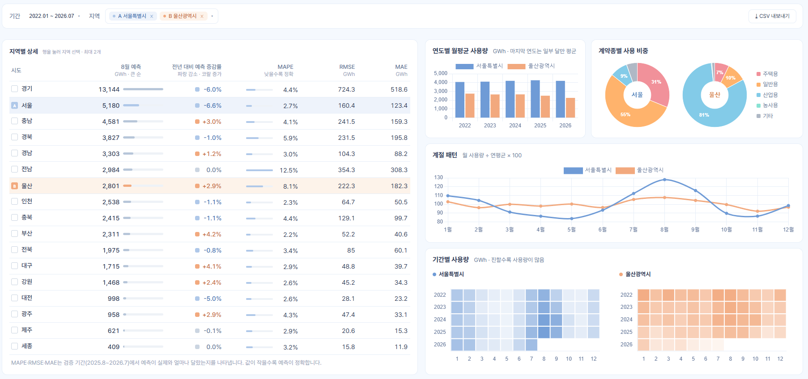

# 전력사용량 예측 모니터링 대시보드

> 전국 17개 시도의 **다음 달 전력 예측치**를 지역끼리 비교하고, 모델이 얼마나 맞혔는지 함께 보여 주는 대시보드


## 한눈에 보기

| 구분 | 내용 |
| --- | --- |
| 팀·기간 | 4인 · 2026.09.18 ~ 10.16 (상세 페이지 담당은 09.30 ~ 10.12) |
| **내 담당** | **상세 페이지 좌측 절반과 그 백엔드 전부** |
| 기술 | Java 17 · Spring Boot · MyBatis · MariaDB · Thymeleaf · Chart.js |
| 원본 저장소 | [`ung-Jin/Predict`](https://github.com/ung-Jin/Predict) 의 fork |
| 작업일지 | [Notion](https://scratched-ceramic-15c.notion.site/3e290bcc7b07808aae43ddc485a81614) |

예측값만 보여 주면 믿을 근거가 없습니다. **지난 12개월 동안 모델이 얼마나 틀렸는지(MAPE·RMSE·MAE)를 같은 표에** 놓아, 숫자를 보는 사람이 스스로 판단할 수 있게 했습니다.

## 내가 만든 것

| | 하는 일 | 파일 |
| --- | --- | --- |
| **지역별 상세 표** | 17개 시도 · 식별 3 + 예측 2 + 정확도 3 열 | [`detail.js`](src/main/resources/static/js/detail.js) |
| **한 쿼리로 합치기** | region · forecast · backtest 세 테이블을 한 번에, 정렬도 SQL 에서 | [`DetailMapper.xml`](src/main/resources/mapper/DetailMapper.xml) |
| **지역 A·B 비교** | 최대 2곳. 표 클릭과 모달이 같은 자리로 들어감 | [`detail.js#L108`](src/main/resources/static/js/detail.js#L108) |
| **CSV 내려받기** | 서버를 거치지 않고 브라우저에서 바로 | [`detail.js#L531`](src/main/resources/static/js/detail.js#L531) |
| **화면 틀·스타일** | 표 레이아웃, 비율 막대, 선택 상태 색 | [`detail.css`](src/main/resources/static/css/detail.css) |

<details><summary>손대지 않은 것</summary>

`detail_charts.html` · `detail-charts.js` · 공통 사이드바·헤더는 팀원 담당입니다.

</details>

## 화면



왼쪽 표에서 지역을 고르면 오른쪽 차트가 같이 바뀝니다. 예측량·MAPE 열은 **최댓값 대비 비율 막대**를 숫자 옆에 그려, 표를 훑기만 해도 큰 지역이 보입니다.

## 핵심 코드

| 주제 | 판단 | 코드 |
| --- | --- | --- |
| 세 테이블 한 쿼리 | 지역·예측·검증을 각각 부르지 않고 **JOIN 한 번으로**. 17행이라 화면에서 합치면 코드가 세 곳으로 흩어진다 | [`DetailMapper.xml#L19`](src/main/resources/mapper/DetailMapper.xml#L19) |
| 정렬을 SQL 에서 | `ORDER BY predictedGwh DESC` 로 끝내고 **JS 는 다시 정렬하지 않는다**. 두 군데서 정렬하면 기준이 어긋날 때 찾기 어렵다 | [`DetailMapper.xml#L46`](src/main/resources/mapper/DetailMapper.xml#L46) |
| 셀마다 함수 하나 | `makeSidoCell` · `makeForecastCell` 처럼 **셀 종류별로 쪼갰다**. 한 함수에서 if 로 나누면 열이 늘 때마다 길어진다 | [`detail.js#L384`](src/main/resources/static/js/detail.js#L384) |
| 비율 막대 | 길이 = 이 지역 예측값 ÷ **전체 최댓값**. 절대값으로 그리면 경기도 하나 때문에 나머지가 전부 안 보인다 | [`detail.js#L418`](src/main/resources/static/js/detail.js#L418) |
| 지역 A·B | 세 번째를 고르면 **A 가 밀려나고 B→A, 새 지역→B**. 둘을 꽉 채운 뒤 더 고를 수 없게 막으면 다시 지우게 해야 한다 | [`detail.js#L108`](src/main/resources/static/js/detail.js#L108) |
| 선택 상태 공유 | `sessionStorage` + `region:selected` 커스텀 이벤트. 팀원 차트 코드와 **서로를 직접 부르지 않고** 느슨하게 이었다 | [`detail.js#L33`](src/main/resources/static/js/detail.js#L33) |
| CSV | `Blob` + `<a download>`. 서버에 파일을 만들지 않으므로 **엔드포인트도 저장 공간도 필요 없다** | [`detail.js#L531`](src/main/resources/static/js/detail.js#L531) |

## 문제 해결

**서버는 200 OK 인데 표가 비어 있었다**

`/detail-api/table` 은 **17행을 200 으로 정상 응답**하고 있었고, DOM 에도 `<tr>` 17개가 멀쩡히 들어 있었습니다. 그런데 화면에는 아무것도 없었습니다.

데이터가 사라진 게 아니라 **놓일 자리가 사라져** 있었습니다.

```
.detail-table   flex-basis: 0      ← 내용과 무관하게 0 에서 시작
.detail-charts  flex-basis: auto   ← Chart.js 캔버스가 자기 폭을 다 가져감
```

`flex` 는 **콘텐츠 크기를 보고** 공간을 나눕니다. 우측 캔버스가 자기 폭을 주장하는 동안 좌측은 0 에서 늘어나지 못하고 찌그러졌습니다. 비율로만 나누는 **Grid 로 바꿔** 해결했습니다.

```css
.detail-body {
  display: grid;
  grid-template-columns: 1.1fr 1fr;   /* 내용이 뭐든 비율은 지켜진다 */
}
```
→ [`detail.css#L29`](src/main/resources/static/css/detail.css#L29)

**배운 것** — "응답이 정상이면 화면도 정상"이 아니었습니다. 데이터 흐름에만 문제가 있을 거라 보고 네트워크와 바인딩만 들여다봤는데 원인은 CSS 였습니다. 이제는 "오는데 안 보인다" 싶으면 **그 요소의 실제 계산된 폭부터** 봅니다.

## 한계

- 예측은 **과거 같은 달 평균 날씨**를 넣고 계산해서, 실제 날씨가 평년과 다르면 빗나갑니다.
- 지역 비교가 **2곳까지**입니다. 셋 이상 겹쳐 보는 기능은 넣지 못했습니다.
- 표는 17행 고정이라 페이징·검색이 없습니다. 행이 늘면 다시 설계해야 합니다.

## 실행 방법

1. MariaDB 에 `project-2` 데이터베이스를 만들고 `predict.sql` → `data.sql` 순서로 실행합니다.
2. `application.yaml` 의 `datasource.url` 을 자신의 DB 주소로 바꿉니다.
3. 서버를 실행하고 `/detail` 로 들어갑니다.

## 배운 점

1. **응답이 정상이어도 화면은 틀릴 수 있습니다.** 200 OK 와 DOM 을 확인하고 원인을 CSS 에서 찾기까지 오래 걸렸습니다.
2. **같은 일을 두 군데서 하지 않기.** 정렬을 SQL 과 JS 양쪽에서 하면 기준이 어긋났을 때 어디가 맞는지 알 수 없습니다.
3. **팀원 코드와는 느슨하게 잇기.** 서로의 함수를 직접 부르는 대신 이벤트로 알려, 상대 코드가 바뀌어도 내 쪽이 안 깨졌습니다.

